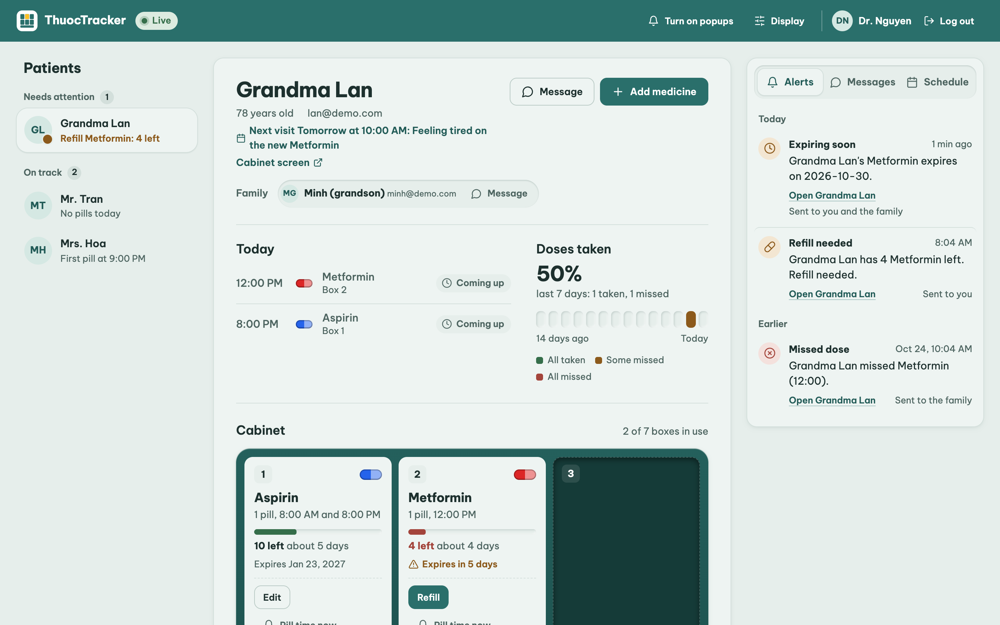
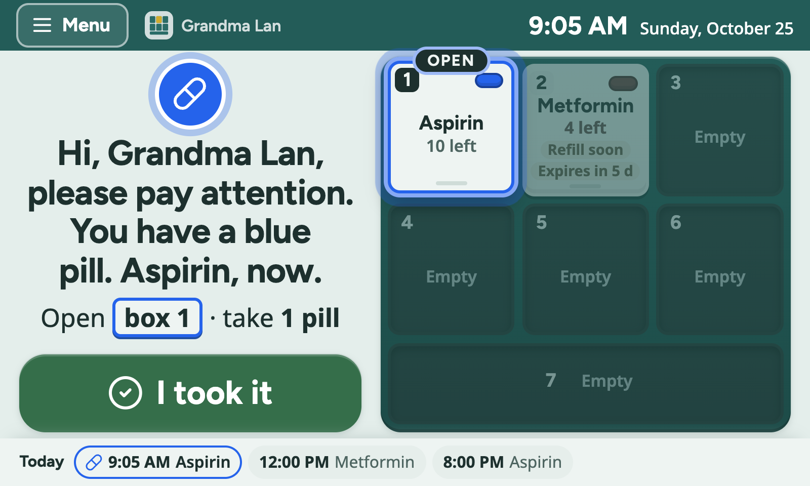
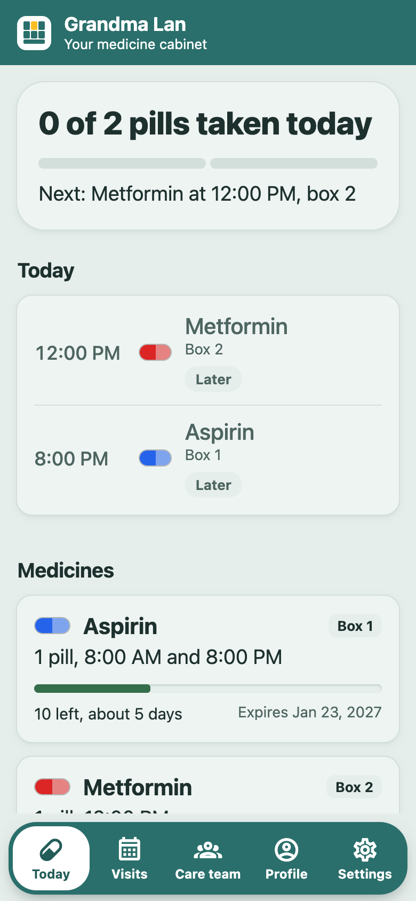
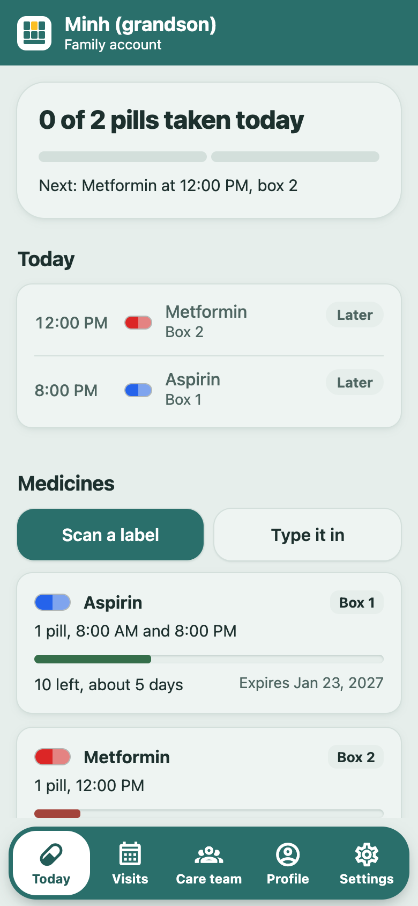

# ThuocTracker

A smart medicine cabinet for elderly and Alzheimer's patients, connected to an app for their doctor.

> The doctor writes the prescription and never knows if it was taken. We close the loop.

Built at HackPSU Fall 2026.

## How it works

- **Cabinet** (Raspberry Pi 5): 3 servo-controlled slots, touchscreen, camera that checks whether a pill was really taken, mic + speaker you can talk to.
- **Doctor dashboard** (web): patients, taken/missed doses, pills left, live alerts.
- **Family alerts** (Expo push to the mobile app): missed dose, low pills, expiring soon.
- **AI**: Gemini reads medicine labels and counts pills from camera photos. Voice questions ("Did I take my pill today?") are heard and answered from the real dose log by Gemma 4 running locally in Ollama, and spoken with ElevenLabs.

## Screenshots

All with the demo data (`/demo/reset`).

**Doctor dashboard** (`/doctor`): each patient's cabinet, today's doses, pills left and expiry dates, a 14-day history, and live alerts, messages and the appointment schedule.



**Cabinet touchscreen** (`/cabinet?patient=1`, on the Pi's 7-inch screen): at pill time it names the pill out loud and opens its box. The patient taps **I took it**, or the camera sees exactly one pill gone.



**Phone app** (Expo): the patient's pills for today and their medicines; the family sees the same cabinet and can add a medicine by scanning its label.

<table>
  <tr>
    <td></td>
    <td></td>
  </tr>
  <tr><td align="center">Patient</td><td align="center">Family</td></tr>
</table>

## Architecture

Nothing talks directly to anything else. The cabinet, screens, phones and AI all go through the backend, and only the backend stores data, calls AI services and sends texts. Everything runs on one laptop on a phone hotspot.

```
 ON THE HOTSPOT                    LAPTOP                              CLOUD

 ┌────────────────────┐     ┌────────────────────────┐
 │ Pi touchscreen     ├────►│ web/  Next.js   :3000  │
 │ (Chromium kiosk)   │     │  /cabinet  touchscreen │
 └────────────────────┘     │  /doctor   dashboard   │
 ┌────────────────────┐     │                        │
 │ Doctor's browser   ├────►│                        │
 └────────────────────┘     └───────────┬────────────┘
                                        │ /api/* proxy
                                        ▼
 ┌────────────────────┐     ┌────────────────────────┐     ┌────────────────────┐
 │ Pi cabinet   pi/   ├────►│ backend/ FastAPI :8000 ├────►│ Gemini             │
 │ servos, camera,    │     │  routes + rules        │     │ labels, pill count │
 │ mic, speaker       │     │  scheduler (every 2 s) │     │                    │
 └────────────────────┘     │  Tiger Data (Postgres) │     ├────────────────────┤
                            │  /audio/*.mp3          ├────►│ ElevenLabs  voice  │
 ┌────────────────────┐     │                        │     ├────────────────────┤
 │ Phones  app/ Expo  │◄───►│  ai/ pure functions    ├────►│ Expo push          │
 │ patient, family,   │     │  (called by routes)    │     │ alerts, pill time, │
 │ doctor             │     │  Ollama Gemma 4: voice │     │ chat               │
 └─────────▲──────────┘     └────────────────────────┘     └─────────┬──────────┘
           │                                                         │
           └──────────────────── push notifications ─────────────────┘
```

| Part | Talks to | How |
|---|---|---|
| Pi (`pi/main.py`) | backend :8000 | polls `GET /cabinet/{id}/command`, posts slot photos and voice questions, plays `/audio/*.mp3` |
| Touchscreen + dashboard (`web/`) | backend via Next.js `/api/*` proxy | polls `/cabinet/{id}/state` every 1 s, dashboard polls every 3 s |
| Mobile app (`app/`) | backend :8000 directly | polls status, alerts and chat; registers for push |
| Backend (`backend/`) | Gemini, ElevenLabs (through `ai/`), Expo push | the only part that decides anything |
| Auth0 login (optional) | dashboard and app → Auth0, then backend → Auth0 `/userinfo` | `POST /login/auth0` trades the Auth0 login for the usual backend session |

### Main flows

**Pill time**
1. The scheduler sees a dose is due → creates a `pending` dose.
2. `ai.speak()` (ElevenLabs) makes "Time for your blue pill" → MP3 in `/audio/`.
3. The Pi gets a command: open slot 2, play the MP3. The screen highlights the slot. The patient's phone gets a push.
4. The Pi photographs the slot before and after. `ai.count_pills()` (Gemini) counts both. Exactly one fewer → **taken**. The patient can also tap "I took it".
5. Nothing after 30 min (30 s with `DEMO=1`) → **missed**, push to family, alert on the dashboard.

**Voice question**
Patient asks "Did I take my pill today?" (Pi mic or the screen's Ask button) → `ai.transcribe()` → `ai.answer()` answers **only from the dose log** (otherwise "ask your doctor") → `ai.speak()` → the Pi or screen plays it.

**New prescription**
Doctor uploads a label photo on the dashboard → `ai.read_label()` (Gemini) fills in name, dose, times and expiration → the doctor checks every field → saved.

**Background checks:** fewer than 5 pills → refill alert to doctor and family. Expires within 7 days → alert to family. Each alert is sent once.

If a cloud service is down, the demo keeps working: the Pi plays 4 stored sounds, pill counting falls back to the "I took it" tap, and texts are printed in the backend console.

**Safety:** the AI never changes a dose. It only reminds and alerts the doctor and family.

## Layout

| Dir | Owner | What |
|---|---|---|
| `backend/` | Backend | API, data contract (`models.py`), rules, push |
| `ai/` | AI | label reading, pill counting, voice (pure functions) |
| `pi/` | Hardware | servos, camera, mic, speaker runtime |
| `web/` | Apps | Next.js: doctor dashboard (`/doctor`) and cabinet touchscreen (`/cabinet`) |
| `app/` | Backend | Expo mobile app for patients, families, doctors: chat + push |

## Run

Three terminals on the backend laptop, all from the repo root. Laptop, phones and Pi must be on the same **2.4 GHz phone hotspot** (campus WiFi blocks device-to-device traffic). Find the laptop IP with `ipconfig` (Windows) or `ipconfig getifaddr en0` (Mac).

**One-time setup**

```bash
cp .env.example .env                      # fill in keys; DEMO=1 for 30 s timings
python -m venv .venv
.venv/bin/pip install -r backend/requirements.txt          # Windows: .venv\Scripts\pip ...
cd web && npm install && cd ..
cd app && npm install && cd ..
```

**1. Backend (port 8000)**

```bash
.venv/bin/python -m uvicorn backend.main:app --reload --host 0.0.0.0
# Windows: .venv\Scripts\python -m uvicorn backend.main:app --reload --host 0.0.0.0
```

Voice questions run on a local model: Ollama hears audio only on an Apple Silicon Mac. On that Mac install [Ollama](https://ollama.com) and run `ollama pull gemma4:e4b-mlx` (9.5 GB, once). If the backend runs on another laptop, make the Mac's Ollama listen on the hotspot (`launchctl setenv OLLAMA_HOST 0.0.0.0`, then quit and reopen Ollama) and put `OLLAMA_URL=http://<mac-ip>:11434` in that laptop's `.env`.

Label scanning (phone app and dashboard) also runs locally, on **Windows or Mac**: install [Ollama](https://ollama.com) and restart the backend. Mac: the `gemma4:e4b-mlx` already pulled for voice is used. Windows: run `ollama pull gemma4:e4b` once (~6.6 GB; the `-mlx` versions run only on Apple Silicon). The backend picks the first installed vision model (gemma4, qwen2.5vl, llama3.2-vision, minicpm-v, llava) or `OLLAMA_VISION_MODEL` from `.env`. A laptop without Ollama falls back to Gemini. Photos are shrunk to 1280 px first (Pillow); on a laptop without a GPU a scan can still take 30-90 s.

API docs: `http://localhost:8000/docs`. Data is in Tiger Data (`DATABASE_URL` in `.env`). Several backends can share the database (e.g. two laptops with the same `.env`): only one runs the scheduler, the others take over if it stops. Check the API end to end with `.venv/bin/python -m backend.test_api` (resets the demo data). Restart after editing `.env` (`--reload` only watches `.py`).

**2. Web: doctor dashboard + cabinet screen (port 3000)**

```bash
cd web && npm run dev
```

Dashboard `http://localhost:3000/doctor`, cabinet `http://<laptop-ip>:3000/cabinet?patient=1`. The web app proxies `/api/*` to the backend (`BACKEND_URL`, default `http://localhost:8000`).

**3. Mobile app (Expo)**

```bash
cd app && npx expo start          # or: npx expo start --tunnel   if the phone can't load it
```

Install **Expo Go** on the phone, scan the QR code (iPhone: Camera app; Android: inside Expo Go). On the login screen check the server (`http://<laptop-ip>:8000`) and log in: `lan@demo.com` (patient), `minh@demo.com` (family) or `doctor@demo.com` (doctor), password `demo1234`. New people tap **Create an account**, in this order: doctor, then patient (enters the doctor's email), then family (enters the patient's email). The app stays logged in. On a computer, `npx expo start --web` runs the same app in the browser; the doctor's full workspace is the dashboard at `:3000/doctor` (same login). Check the phone can reach the backend by opening `http://<laptop-ip>:8000/health` in its browser. Allow Python and Node through Windows Firewall when asked.

Notifications: in Expo Go they show while the app is running. Real push needs `npx eas init` in `app/` (Expo account), and on Android a development build (`npx eas build --profile development --platform android`).

**Auth0 login (optional)**

Email + password keeps working everywhere. Auth0 adds a **Continue with Auth0** button (tenant `dev-igr7vxhgin21kqfz.us.auth0.com`).

- **Backend:** `AUTH0_DOMAIN` in `.env` (see `.env.example`). Without it, `POST /login/auth0` answers 503 and nothing else changes.
- **Dashboard:** needs `web/.env.local` with the "ThuocTracker Doctor Dashboard" app's keys (`APP_BASE_URL`, `AUTH0_DOMAIN`, `AUTH0_CLIENT_ID`, `AUTH0_CLIENT_SECRET`, `AUTH0_SECRET`), from the [Auth0 dashboard](https://manage.auth0.com/dashboard/us/dev-igr7vxhgin21kqfz/applications/aOI4mzS4jSqhf2IPqFGiS3jJXRxJxZuW/settings). It works only at `http://localhost:3000/doctor` (the callback Auth0 allows). A new email gets a doctor account.
- **App:** the button appears only in a development build made after Auth0 was added, not in Expo Go or older APKs. It logs into existing accounts only (new people tap **Create an account** first). Run `npx expo start` without `--go` and open the ThuocTracker app.
  - Android: `cd app && npx eas build --profile development --platform android`, then install the new APK.
  - iPhone with a free Apple ID: plug it in, `cd app && npx expo run:ios --device`, then on the phone **Settings → General → VPN & Device Management → Trust** your Apple ID. Free builds stop opening after 7 days (run it again). iOS push is off (`enableRemoteNotifications: false` in `app/app.json`) because free accounts can't sign it; turn it back on with a paid Apple Developer account.
- An email that already has an account must be verified in Auth0, so the `@demo.com` demo accounts can't use Auth0: log in with their password.
- Test the account rules without Auth0: `.venv/bin/python -m backend.test_auth0`.

On the Pi: `pip install -r pi/requirements.txt`, then `BACKEND_URL=http://<laptop-ip>:8000 python pi/main.py`.
Use a 2.4 GHz phone hotspot for the laptop and the Pi, not campus WiFi.

## Status

Working end to end on Tiger Data with sign-up, login and chat. Live progress and who is doing what: `TEAM.md`.
