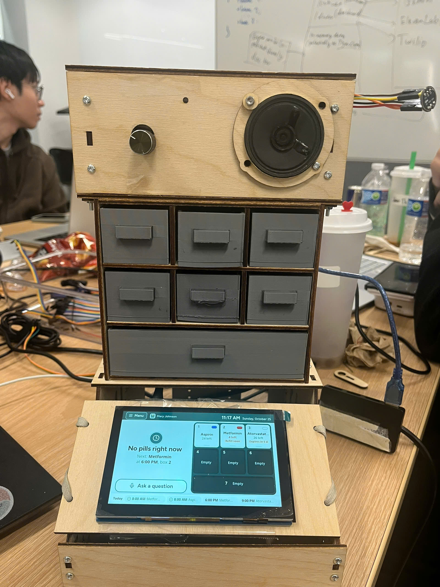
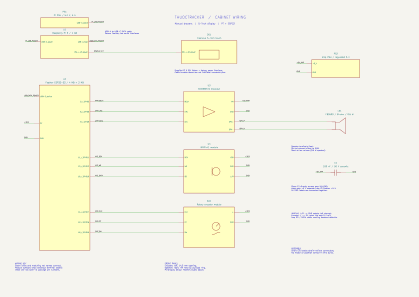

# ThuocTracker hardware

Manual drawers, a 5-inch touchscreen, and voice controls. The Pi runs the screen
and talks to the ESP32 over USB. The ESP32 handles the speaker, microphone and knob.

## Wiring

Open [cabinet.kicad_pro](schematic/cabinet.kicad_pro) in KiCad to edit the schematic.
Keep its symbol library and table beside it.
Symbols show module terminals, not bare-chip pins. Matching net labels connect;
USB and display connections represent complete cables.

| ESP32 Feather pin | Connect to |
|---|---|
| 5, 6, 9 | MAX98357A BCLK, LRC, DIN |
| 11, 12, 10 | INMP441 SCK, WS, SD |
| A1 / GPIO17 | Encoder CLK |
| A2 / GPIO16 | Encoder DT |
| A3 / GPIO15 | Encoder SW |
| 3V | Microphone VDD and encoder + |
| GND | Amp GND, mic GND and L/R, encoder GND, amp supply negative |

Power the Pi with its USB-C supply. Connect Pi USB-A to Feather USB-C with a data
cable. Use a separate regulated 5 V supply for amp VIN; join grounds, not supply
positives. Put the 100 nF ceramic capacitor across amp VIN/GND near the board.
Speaker wires go only to SPK+ and SPK−. Start quietly: this speaker is rated 0.5 W.
Keep the working amp SD/GAIN defaults. Use the screen's supplied Pi 5 ribbon,
power interface and mounting kit.

Firmware and setup: [pi/esp32](../pi/esp32/README.md). Keep `HALL_ENABLED=False`;
include `servo` and `camera` in the Pi's `MOCK` list and use `AUDIO=esp32`.

## Make and assemble

- `stl/`: print the same small drawer ×6 and wide drawer ×1. Reuse finished parts.
  PLA, 100% scale, floor on bed, cavity up; 0.2 mm layers, 4 walls, 20% infill.
- `dxf/`: 3 mm plywood, millimetres, 100% scale. Each file contains one part;
  duplicate by its `QTY` suffix. Frame: 11 pieces; top: 11; base: 8.
  `optional/` holds unused actuator parts. Check the base floor imports at 176 ×210 mm.
- `cad/`: editable OpenSCAD, assembled/exploded views and a preview.
- `photos/`: actual build photos.

Encoder goes front-left in the 14.5 mm hole; speaker goes front-right. Hole centre
is approximate. Clamp the speaker's metal rim with the ring and a soft gasket.
Mount Pi behind the display using the supplied M2.5 hardware. Keep ribbon slack
and ventilation clear. Use short breadboards upstairs; a full-size board won't fit.

Full build: 58 M3×16 screws (4 low-head), 2 M3×12, about 70 plain M3 nuts and
80 washers including spares. Upper-floor screw heads plus washers must fit the
2.7 mm clearance. The two frame-to-base bolts need 1 mm shims; check their tips
clear the drawer. Fit feet at least 5 mm tall. Snug the plywood joints by hand.

## Rough budget (USD)

| Parts | Estimate |
|---|---:|
| Pi 5 1 GB + Feather ESP32-S3 | $62.50 |
| Freenove 5-inch display | $36 |
| MAX98357A, FBS50D speaker, INMP441, encoder | $13 |
| Two supplies, USB cable, microSD, breadboards and wiring | $44 |
| Plywood and PLA | $23 |
| Screws, nuts and washers | $9.40 |
| Feet, gasket and mounts | $3.50 |
| **Replacement-build total** | **About $191** |

Owned/borrowed parts reduce spending. Prices are allowances, excluding shipping.
CAD comes from our earlier V7 plywood design; the small-drawer STL is unchanged.
Dimensions and meshes were checked digitally; final hardware fit needs a bench check.
